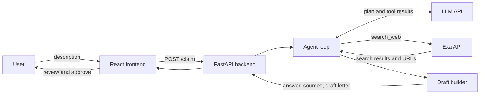

# Reklama architecture

Reklama focuses on consumer rights and compensation for delayed flights, defective products, and incorrect invoices. The user describes the issue in free text. The agent researches applicable laws, authority guidance, and the company's terms and complaint process, then prepares an answer and ready-to-send complaint letter. The user reviews and approves it; the app never sends it.

## Request flow

The agent plans with the LLM, calls `search_web` backed by Exa, reads the results, and repeats until it has enough information or reaches `MAX_ROUNDS = 5`. Every source URL must originate in Exa results; the LLM must never invent links. The scaffold returns stable fake source data when `EXA_API_KEY` is absent, keeping `/claim` usable for development.
