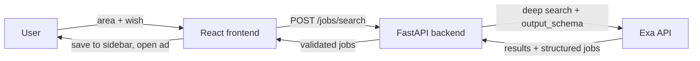

# Architecture

The app is a job search for people who can describe what they want but not which job titles to search for. The user gives an area and a free-form wish. The backend sends those words almost verbatim to Exa deep search, which expands them into its own queries and returns structured job ads. The frontend shows three ads at a time.

## Request flow

- `/jobs/search`: Exa deep search with a 21-day freshness filter, highlights and an output schema (title, employer, location, url, deadline, application status and evidence, summary, why). No separate LLM call.
- Every returned URL must be one of Exa's own results; anything else is dropped. Ads the user has already seen (`exclude_urls`) are dropped too.
- Exa classifies each ad as `open`, `closed`, or `unknown` and returns a short source excerpt as internal evidence. The backend drops closed ads and any ad with a past deadline, keeps open and unknown ads, and sorts open ads first. Evidence is not included in the API response. Unknown status is shown in the UI as a reminder to check the deadline. Older saved browser entries without a status are treated as open.
- Exa is asked to exclude `bebee.com`, `jooble.org`, `careerjet.fi`, `jobleads.com`, and `drjobpro.com`; these aggregators can retain old ads without exposing that they are closed.
- The frontend accepts a free-form location with no area allowlist. If a place name is ambiguous across countries, Exa defaults to the Finnish location unless the user specifies another country. A blank area has no geographic restriction.
- The same position posted on several sites is shown once: ads are compared by title and employer, within a batch and against jobs already shown (`seen_jobs`).
- Only Exa's structured jobs become cards; raw search results without a summary are not shown.
- Rejecting a batch with feedback ("too far away") sends the feedback with the next search.
- Saved ads live in the browser's `localStorage`; there is no database.
- Without `EXA_API_KEY` the backend returns a stub ad so the app still runs.
- Identical searches are cached in memory for an hour; a global hourly limit protects Exa credits.
- Hosting: one Docker container on Render serves the built frontend and the API from the same origin.

## Why Exa deep search directly

A benchmark (8 vague Finnish wishes, every link fetched and checked) compared a plain LLM, Gemini with Google Search grounding, Gemini writing Exa queries, and Exa deep search on the raw text. Exa deep search with an output schema gave the most ads that were still open (87 %, vs 28 % for Google grounding and 0 % for a plain LLM), from 14 different sites, with no invented links and no LLM tokens.
